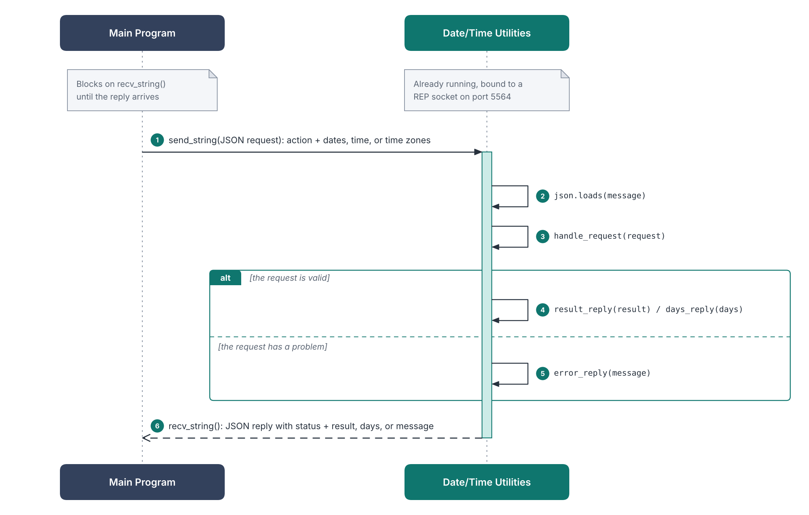

# Date/Time Utilities Microservice

## What this microservice does

The Date/Time Utilities microservice does the date and time work so your program doesn't have to. It does not know anything about your program, so it works for any kind of date, such as a medical visit, a trip, a study session, or when a movie was watched.

It can do four things:

- **format_date**: write a date the way you want to show it, such as `October 30, 2026` or `Oct 30, 2026`
- **duration**: count the days between a start date and an end date
- **convert_timezone**: take a date and time in one time zone and tell you what it is in another time zone (daylight saving time is handled for you)
- **relative_date**: describe a date compared to today, such as `3 days ago` or `in 2 days`

The microservice uses ZeroMQ with the Request Reply pattern and listens on port **5564**. All messages are JSON text.

## How to run it

1. Install the ZeroMQ library and the time zone data for Python: `py -m pip install pyzmq tzdata`
2. Start the microservice and leave it running: `py date_time_service.py`
3. To stop it, press the Control key and the C key together.

## How to REQUEST data from the microservice

Connect a ZeroMQ REQ socket to `tcp://localhost:5564`, turn your request into JSON text, and send it. Send one request at a time. The microservice sends back exactly one reply for each request.

Request parameters:

- **action** (required): `"format_date"`, `"duration"`, `"convert_timezone"`, or `"relative_date"`
- **date** and **style** (required for format_date): date is written as MM/DD/YYYY, and style is `"long"` or `"short"`
- **start_date** and **end_date** (required for duration): written as MM/DD/YYYY. The end_date must not be before the start_date.
- **datetime**, **from_tz**, and **to_tz** (required for convert_timezone): datetime is written as MM/DD/YYYY HH:MM with a 24 hour clock, such as `10/30/2026 14:00`. The time zones are names such as `America/New_York`, `Europe/Berlin`, or `UTC`. The full list is in the "TZ identifier" column here [on this page](https://en.wikipedia.org/wiki/List_of_tz_database_time_zones). 
- **date** (required for relative_date): written as MM/DD/YYYY 

Every date needs two digits for the month and the day, so write `03/07/2026`, not `3/7/2026`.

Example request call (Python with pyzmq):

```python
import zmq, json

context = zmq.Context()
socket = context.socket(zmq.REQ)
socket.connect("tcp://localhost:5564")

request = {
    "action": "convert_timezone",
    "datetime": "10/30/2026 14:00",
    "from_tz": "America/New_York", 
    "to_tz": "Europe/Berlin"
}
socket.send_string(json.dumps(request))
```

The other requests are sent the same way, with different fields:

```python
{"action": "format_date", "date": "10/30/2026", "style": "long"}
{"action": "duration", "start_date": "10/01/2026", "end_date": "10/30/2026"}
{"action": "relative_date", "date": "11/10/2026"}
```

## How to RECEIVE data from the microservice

After you send a request, wait for the reply on the same socket. The reply is JSON text, so turn it back into a Python dictionary with `json.loads`.

If a **format_date**, **convert_timezone**, or **relative_date** request worked, the reply looks like this:

```
{"status": "ok", "result": "10/30/2026 19:00"}
```

The result is always a string. Here is what each action gives back:

| Action | Example result |
|---|---|
| format_date with style `"long"` | `"October 30, 2026"` |
| format_date with style `"short"` | `"Oct 30, 2026"` |
| convert_timezone | `"10/30/2026 19:00"` (MM/DD/YYYY HH:MM, and the date can change if the time crosses midnight) |
| relative_date | `"today"`, `"1 day ago"`, `"3 days ago"`, `"in 1 day"`, or `"in 3 days"` |

For relative_date, "today" means the date on the computer that is running the microservice.

If a **duration** request worked, the reply looks like this. The days value is a whole number, and two dates that are the same give 0.

```
{"status": "ok", "days": 29}
```

If something is wrong with the request, the reply looks like this, and the microservice keeps running so it can answer your next request:

```
{"status": "error", "message": "...what went wrong..."}
```

Possible error messages:

- `Request must be valid JSON text`
- `Request must be a JSON object`
- `Unknown action: <the action you sent>`
- `Missing required field: <the field name>`
- `Date is not valid. Use MM/DD/YYYY` (the date is not written as MM/DD/YYYY, or the month is over 12, such as `13/45/2026`)
- `Date is not valid. Date out of range` (that day does not exist, such as `12/32/2026` or `02/29/2027`)
- `end_date must not be before start_date`
- `Datetime is not valid. Use MM/DD/YYYY HH:MM`
- `Time is not valid. Use HH:MM (24 hour clock)`
- `Unknown time zone: <the time zone you sent>`
- `style must be "long" or "short"`

Example receive call (Python with pyzmq), which continues from the request above:

```python
reply = json.loads(socket.recv_string())

if reply["status"] == "ok":
    print(reply["result"])
else:
    print(reply["message"])
```

Example reply for the request above:

```
{"status": "ok", "result": "10/30/2026 19:00"}
```

For a duration request, read `reply["days"]` instead of `reply["result"]`.

## UML sequence diagram

This diagram shows how a request and a reply travel between your program and the microservice.



## How to test it

1. Start the microservice: `py date_time_service.py`
2. Open a second PowerShell window in the same folder and run the test program: `py test_date_time.py`
3. The test program prints each request, each reply, and PASS or FAIL for each test.

